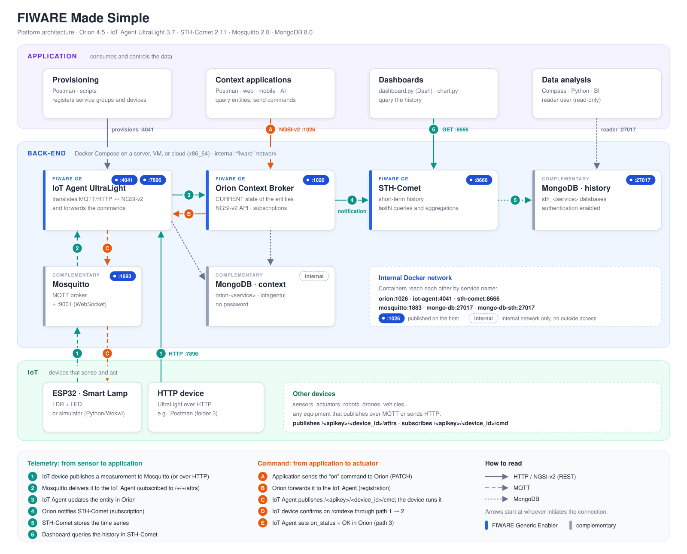

<div align="center">

# FIWARE Made Simple

**A complete FIWARE platform for IoT projects, ready to run with a single command.**

Orion Context Broker · IoT Agent UltraLight · STH-Comet · Mosquitto · MongoDB

[](https://fiware-orion.readthedocs.io/)
[](https://fiware-iotagent-ul.readthedocs.io/)
[](https://fiware-sth-comet.readthedocs.io/)
[](https://www.mongodb.com/docs/manual/)
[](https://mosquitto.org/)
[](https://docs.docker.com/compose/)
[](LICENSE)
[](https://github.com/fabiocabrini/fiware-made-simple/actions/workflows/test.yml)

</div>

---

**FIWARE Made Simple** brings the main *Generic Enablers* of the [FIWARE Foundation](https://www.fiware.org/) together in a single `docker-compose.yml`, already configured to work with each other. It was designed for **teaching, research, and proofs of concept (PoCs)**: students, researchers, and makers can start the platform in minutes on a laptop, a lab server, or in the cloud, and spend their time learning IoT instead of configuring infrastructure.

<p align="center">
  
</p>

## Highlights

- **One command starts everything.** Six services with pinned versions, health checks, and startup in the right order.
- **Complete IoT flow.** Telemetry (sensor → Orion → history) and commands (application → actuator) with execution confirmation.
- **Tested end to end.** The [`scripts/smoke-test.sh`](scripts/smoke-test.sh) script checks the whole platform in about 15 seconds, and every change is tested automatically on GitHub Actions.
- **Complete examples.** ESP32 firmware, a Python simulator, and dashboards, all tested against the platform.
- **Ready-made Postman collection.** A guided path with variables and automated tests that also lets you simulate the device without hardware.
- **Accessible historical data.** A dedicated history database with a read-only user for Python, Compass, or BI tools.
- **Lightweight.** About 600 MiB of memory for the whole platform, and 850 MiB with 20 active devices.

## Requirements

| | Minimum | Recommended |
|---|---|---|
| **Operating system** | x86_64 Linux, Windows 10/11 with WSL 2, or macOS | Ubuntu Server 26.04 LTS |
| **Processor** | 1 x86_64 core with AVX | 2 cores |
| **Memory** | 1 GB, with swap | 2 GB (4 GB for classrooms) |
| **Free disk space** | 5 GB | 20 GB |
| **Software** | Docker Engine 20.10+ with Compose v2 | Latest Docker release |

ARM processors on Linux, such as Raspberry Pi, AWS Graviton, and Oracle Ampere, are **not supported**. Macs with Apple Silicon work through emulation. Details, measured numbers, and suggested cloud instances are in [Requirements and installation](docs/03-installation.md#requirements).

## Quick start

```bash
git clone https://github.com/fabiocabrini/fiware-made-simple.git
cd fiware-made-simple
./scripts/check-requirements.sh   # checks whether this machine is ready
cp .env.example .env              # change the passwords before using it in the cloud
docker compose up -d --wait       # waits until every service is healthy
./scripts/smoke-test.sh           # optional: validates the platform end to end
```

On a Mac with Apple Silicon, run `export DOCKER_DEFAULT_PLATFORM=linux/amd64` first.

Then import the [Postman collection](postman/) and follow the path in [Getting started](docs/04-getting-started.md). Coming from the previous version? See the [migration guide](CHANGELOG.md#migrating-from-version-1).

## Documentation

| | Chapter | Contents |
|---|---|---|
| 1 | [Concepts](docs/01-concepts.md) | FIWARE, NGSI-v2, entities, IoT Agent, subscriptions, and multi-tenancy |
| 2 | [Architecture](docs/02-architecture.md) | Layers, components, telemetry and command flows, ports, and databases |
| 3 | [Requirements and installation](docs/03-installation.md) | Hardware, operating systems, cloud, Docker on Linux/Windows/macOS, operation, and reset |
| 4 | [Getting started](docs/04-getting-started.md) | Guided path with the Postman collection, from provisioning to history |
| 5 | [Smart Lamp PoC](docs/05-smart-lamp.md) | ESP32 with LDR and LED: circuit, MQTT topics, and commands |
| 6 | [Historical data](docs/06-historical-data.md) | STH-Comet, queries, aggregations, and MongoDB access |
| 7 | [Security](docs/07-security.md) | Limits of this platform and how to prepare it for exposed environments |
| 8 | [Troubleshooting](docs/08-troubleshooting.md) | Common errors and how to diagnose them |
| | [Examples](examples/) | ESP32 firmware, Python simulator, and history dashboards |

## Components

| Component | Role | Port |
|---|---|---|
| [Orion Context Broker](https://fiware-orion.readthedocs.io/) | Current state of the entities (NGSI-v2 API) | 1026 |
| [IoT Agent UltraLight 2.0](https://fiware-iotagent-ul.readthedocs.io/) | Translates device MQTT/HTTP into NGSI-v2 | 4041 · 7896 |
| [STH-Comet](https://fiware-sth-comet.readthedocs.io/) | Short-term history and aggregations | 8666 |
| [Eclipse Mosquitto](https://mosquitto.org/) | MQTT broker | 1883 · 9001 |
| [MongoDB](https://www.mongodb.com/docs/manual/) (context) | Database of Orion and the IoT Agent, internal network only | internal |
| [MongoDB](https://www.mongodb.com/docs/manual/) (history) | STH-Comet database, with authentication | 27017 |

> [!IMPORTANT]
> FIWARE Made Simple is intended for **teaching, research, and PoCs** and includes neither API authentication nor encryption. Before exposing the platform to the internet, read [Security](docs/07-security.md).

## Resources

- [Smart Lamp simulation on Wokwi](https://wokwi.com/projects/477282758850200577)
- [Official FIWARE tutorials](https://fiware-tutorials.readthedocs.io/)
- [Generic Enablers catalog](https://www.fiware.org/catalogue/)
- [Smart Data Models](https://smartdatamodels.org/)

## Author and citation

**Fábio Henrique Cabrini**: material developed for teaching and research in the Internet of Things, adapted from the [FIWARE Foundation tutorials](https://github.com/FIWARE/tutorials.IoT-over-MQTT).

If you use FIWARE Made Simple in academic work, use the **Cite this repository** button on GitHub or the [`CITATION.cff`](CITATION.cff) file.

Released under the [MIT license](LICENSE). Version history in [`CHANGELOG.md`](CHANGELOG.md).
