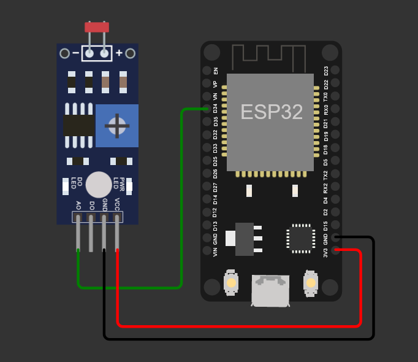

# 5. Smart Lamp PoC

The **Smart Lamp** is the proof of concept that comes with the platform: an ESP32 measures the ambient luminosity with an LDR sensor and turns an LED on or off through commands sent from any application. It exercises both flows of the architecture, telemetry and commands, with low-cost hardware.

**On this page:** [Bill of materials](#bill-of-materials) · [Circuit](#circuit) · [Entity model](#entity-model) · [MQTT contract](#mqtt-contract) · [Step by step](#step-by-step) · [Without hardware](#without-hardware)

---

## Bill of materials

| Item | Notes |
|---|---|
| ESP32 DevKit V1 (DOIT) | Espressif 32-bit microcontroller with 802.11 b/g/n Wi-Fi and Bluetooth |
| Light sensor module (LDR) | With an analog `AO` output |
| LED | The DevKit *onboard* LED (GPIO 2) is enough |
| Jumper wires and a micro-USB cable | |

## Circuit

<p align="center">
  
</p>

| LDR module | ESP32 |
|---|---|
| `VCC` | `3V3` |
| `GND` | `GND` |
| `AO` (analog output) | `D34` (GPIO 34, ADC input) |

The ADC reading (0 to 4095) is converted to a 0 to 100 scale before it is sent.

## Entity model

During provisioning (step 2.3 of the collection), the `lamp001` device is mapped to the `urn:ngsi-ld:Lamp:001` entity:

| On the device | In the entity (Orion) | Type | Meaning |
|---|---|---|---|
| `l` | `luminosity` | `Integer` | Measured luminosity, from 0 to 100 |
| `s` | `state` | `Text` | Current LED state: `on` or `off` |
| `on` command | `on_status`, `on_info` | | Turns the LED on; execution status and response |
| `off` command | `off_status`, `off_info` | | Turns the LED off; execution status and response |

The short names (`l`, `s`) save bytes on the wire; the IoT Agent translates them into the full names.

## MQTT contract

The device talks **only to the MQTT broker** (port 1883) and knows nothing about Orion. With `apikey` set to `TEF` and `device_id` set to `lamp001`:

| Direction | Topic | Message | When |
|---|---|---|---|
| Publishes | `/TEF/lamp001/attrs` | `s\|on` or `s\|on\|l\|42` | When the state changes; several attributes at once |
| Publishes | `/TEF/lamp001/attrs/l` | `42` | On every sensor reading; one attribute per message |
| Subscribes | `/TEF/lamp001/cmd` | `lamp001@on\|` or `lamp001@off\|` | Receives the commands |
| Publishes | `/TEF/lamp001/cmdexe` | `lamp001@on\|ok` | Confirms that the command was executed |

> [!IMPORTANT]
> **Always confirm the command on `/cmdexe`.** That message is what makes the IoT Agent change `on_status` from `PENDING` to `OK` in Orion. Without it, the application has no way of knowing whether the command was executed. The text after the `|` (in the example, `ok`) is copied into `on_info`.

> [!TIP]
> **Publishing rate.** Publishing every second produces about 86,000 records per day in the history. For most applications, sending the luminosity every 5–10 seconds, and the state only when it changes, is enough and saves energy, network, and disk.

## Step by step

1. **Start the platform** and confirm that everything is healthy ([Requirements and installation](03-installation.md)).
2. **Provision** the device with folder **2** of the collection, which creates the service group, the device, and the subscription ([Getting started](04-getting-started.md)).
3. **Flash the firmware** from [`examples/esp32-smart-lamp`](../examples/esp32-smart-lamp/) to the ESP32, after setting the Wi-Fi network, the server IP, the `apikey`, and the `device_id` (instructions in the example README).
4. **Follow the telemetry:** request 3.2 shows `luminosity` changing with the light on the sensor.
5. **Send commands** with 4.1 and 4.2: the LED turns on and off, and 4.3 shows `on_status: OK`.
6. **Query the history** with folder 5 or with the dashboard ([Historical data](06-historical-data.md)).

To inspect the MQTT traffic directly on the server:

```bash
docker compose exec mosquitto mosquitto_sub -t '/TEF/#' -v
```

## Without hardware

- **Wokwi:** the [Smart Lamp simulation](https://wokwi.com/projects/477282758850200577) runs the same ESP32 firmware in the browser and connects to your platform over the internet. Set `MQTT_BROKER` to your server address; the server needs a public IP with port 1883 open.
- **Python simulator:** [`examples/python-simulator`](../examples/python-simulator/) reproduces the firmware, including the command confirmation.
- **Postman:** folder 3 of the collection sends measurements over HTTP (port 7896), without MQTT.
- **Terminal:** publish a measurement straight to the broker:

  ```bash
  docker compose exec mosquitto mosquitto_pub -t /TEF/lamp001/attrs/l -m 55
  ```

---

[← 4. Getting started](04-getting-started.md) · [Index](../README.md#documentation) · Next: [6. Historical data →](06-historical-data.md)
